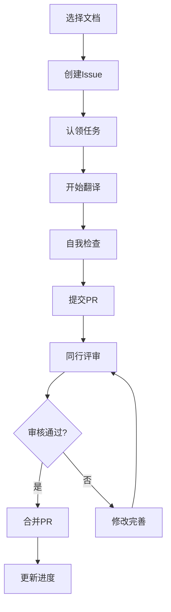

# Kubernetes 中文文档现代化升级计划

## 📋 项目现状分析

### 当前问题
- **版本严重过时**: 基于 Kubernetes v1.1 (2015年)，当前最新版本为 v1.33 (2025年)
- **翻译完成度极低**: 150+ 文档中仅约10个包含中文内容
- **技术栈陈旧**: Jekyll + GitHub Pages，缺乏现代化功能
- **社区分散**: 多个并存项目，缺乏统一协调

### 竞品分析
1. **k8smeetup/k8s-official-translation** (已归档)
2. **kubernetes-retired/kubernetes-docs-zh** (已废弃)  
3. **pkgdoc/kubernetes-handbook** (活跃项目)
4. **kubernetes.kansea.com** (个人维护)

## 🎯 升级目标

### 短期目标 (3个月)
- [ ] 建立现代化技术架构
- [ ] 完成核心概念文档翻译 (20篇)
- [ ] 建立标准化翻译流程
- [ ] 组建核心翻译团队 (10人)

### 中期目标 (6个月)
- [ ] 完成用户指南翻译 (50篇)
- [ ] 实现自动化同步机制
- [ ] 建立质量保证体系
- [ ] 扩展社区贡献者 (50人)

### 长期目标 (12个月)
- [ ] 完成完整文档翻译 (200+ 篇)
- [ ] 建立持续维护机制
- [ ] 成为官方认可的中文文档
- [ ] 建立培训和认证体系

## 🛠 技术架构设计

### 核心技术栈
```yaml
文档生成:
  框架: VuePress 3.x
  原因: Vue生态完善，中文支持好，插件丰富
  
部署平台:
  主要: Vercel (性能优秀，CDN全球)
  备份: Netlify, GitHub Pages
  
协作工具:
  任务管理: GitHub Issues + Projects
  翻译平台: Crowdin (专业翻译管理)
  代码管理: GitHub (标准化流程)
  
自动化:
  CI/CD: GitHub Actions
  同步: 上游文档自动检测更新
  质检: 自动化翻译质量检查
```

### 项目结构
```
kubernetes-docs-cn-v2/
├── docs/                    # 文档内容
│   ├── concepts/           # 核心概念
│   ├── tutorials/          # 教程指南  
│   ├── tasks/              # 任务说明
│   ├── reference/          # 参考文档
│   └── contribute/         # 贡献指南
├── .vuepress/              # VuePress 配置
│   ├── config.ts          # 主配置文件
│   ├── theme/             # 自定义主题
│   └── components/        # 自定义组件
├── scripts/                # 自动化脚本
│   ├── sync-upstream.js   # 同步上游更新
│   ├── quality-check.js   # 质量检查
│   └── deploy.js          # 部署脚本
└── tools/                  # 翻译工具
    ├── glossary.json      # 术语表
    ├── style-guide.md     # 翻译规范
    └── review-checklist.md # 审核清单
```

## 📝 翻译策略

### 优先级分级
```markdown
P0 (核心概念 - 立即开始):
- Pod, Service, Deployment 概念解析
- 集群架构和组件介绍
- kubectl 基础使用指南

P1 (用户指南 - 第二阶段):
- 应用部署和管理
- 配置和密钥管理
- 网络和存储基础

P2 (管理指南 - 第三阶段):
- 集群安装和配置
- 安全和权限管理
- 监控和故障排查

P3 (高级主题 - 第四阶段):
- API 扩展和自定义资源
- Operator 开发指南
- 性能调优和最佳实践
```

### 翻译规范
```yaml
术语标准化:
  - 建立统一术语表
  - 核心概念保持英文 (Pod, Service等)
  - 技术术语中英对照

格式要求:
  - 保留原文结构和格式
  - 中英文混排使用空格分隔
  - 代码块和命令不翻译
  - 链接和锚点保持原样

质量标准:
  - 准确性: 技术内容准确无误
  - 可读性: 符合中文表达习惯
  - 一致性: 术语和风格统一
  - 完整性: 不遗漏重要信息
```

## 👥 团队建设计划

### 组织架构
```
项目负责人 (1人)
├── 技术架构师 (1人)
├── 翻译协调员 (2人)  
├── 核心翻译者 (8人)
├── 审校人员 (4人)
└── 社区管理员 (2人)
```

### 角色职责
- **项目负责人**: 整体规划，对外协调，质量把控
- **技术架构师**: 技术选型，工具开发，自动化建设
- **翻译协调员**: 任务分配，进度跟踪，冲突解决
- **核心翻译者**: 文档翻译，术语维护，新人指导
- **审校人员**: 质量审核，风格统一，技术校对
- **社区管理员**: 社区运营，用户支持，反馈收集

### 招募策略
1. **技术社区**: 在 K8s 中文社区发布招募信息
2. **高校合作**: 与计算机专业建立合作关系
3. **企业参与**: 邀请使用 K8s 的企业参与贡献
4. **激励机制**: 建立贡献者认证和奖励体系

## 🔄 工作流程设计

### 翻译流程


### 质量保证流程
1. **翻译前**: 术语查询，样式检查
2. **翻译中**: 实时协作，冲突避免  
3. **翻译后**: 自动检查，人工审核
4. **发布前**: 最终校对，测试验证

## 📊 项目管理

### 进度跟踪
- **GitHub Projects**: 可视化任务看板
- **自动化报告**: 每周进度自动生成
- **里程碑管理**: 按版本设置检查点
- **数据分析**: 翻译效率和质量统计

### 沟通协调
- **定期会议**: 双周同步会议
- **即时沟通**: 微信群/Slack 频道
- **文档协作**: 共享文档和规范
- **问题反馈**: GitHub Issues 统一管理

## 💰 资源需求

### 技术资源
- **域名**: kubernetes-cn.org (建议)
- **服务器**: CDN 和构建服务 ($50/月)
- **工具订阅**: Crowdin Pro ($99/月)
- **监控服务**: 网站性能监控 ($20/月)

### 人力投入
- **项目负责人**: 20小时/周
- **核心团队**: 10小时/周/人 × 15人
- **社区贡献者**: 5小时/周/人 × 30人
- **总计**: 约320小时/周

## 📈 成功指标

### 量化指标
- **翻译完成度**: 目标 90% (200+ 篇文档)
- **翻译质量**: 审核通过率 > 95%
- **社区活跃度**: 月活跃贡献者 > 50人
- **用户使用**: 月访问量 > 100k PV

### 质量指标  
- **准确性**: 技术错误率 < 1%
- **一致性**: 术语统一率 > 98%
- **时效性**: 新版本同步 < 1个月
- **可用性**: 网站可用性 > 99.5%

## 🎯 执行计划

### 第一阶段 (月1-2): 基础建设
- [ ] 完成技术架构搭建
- [ ] 建立翻译规范和流程
- [ ] 组建核心团队
- [ ] 完成首批10篇核心文档

### 第二阶段 (月3-4): 内容建设  
- [ ] 完成核心概念文档翻译
- [ ] 建立自动化工具链
- [ ] 扩展翻译团队
- [ ] 完成用户指南50%

### 第三阶段 (月5-8): 规模扩展
- [ ] 完成用户指南翻译
- [ ] 开始管理员指南翻译
- [ ] 建立社区运营体系
- [ ] 实现自动同步机制

### 第四阶段 (月9-12): 完善优化
- [ ] 完成全部文档翻译
- [ ] 优化用户体验
- [ ] 建立长期维护机制
- [ ] 申请官方认可

## 🤝 合作机会

### 潜在合作伙伴
- **CNCF**: 申请官方支持和认可
- **阿里云/腾讯云**: 云厂商技术支持
- **高校**: 学术合作和人才培养
- **企业**: 实践案例和资源支持

### 合作模式
- **技术支持**: 提供基础设施和工具
- **内容贡献**: 参与翻译和审校工作
- **推广合作**: 共同推广和运营
- **培训认证**: 联合开展培训项目

---

## 总结

这个现代化升级计划将彻底改造现有的 Kubernetes 中文文档项目，通过现代化的技术架构、标准化的翻译流程、专业化的团队建设，为中文 Kubernetes 社区提供高质量、持续更新的文档资源。

项目成功的关键在于：
1. **技术先进**: 采用现代化工具和自动化流程
2. **团队专业**: 建立专业化的翻译和管理团队  
3. **流程标准**: 建立标准化的翻译和质量保证流程
4. **社区驱动**: 建立活跃的社区参与和贡献机制
5. **持续改进**: 建立持续学习和改进的文化

通过这个计划的实施，我们将为中文 Kubernetes 社区建立一个世界级的文档资源平台。